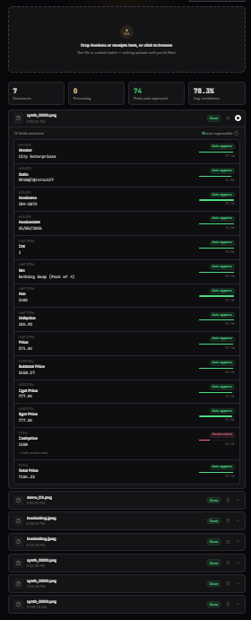
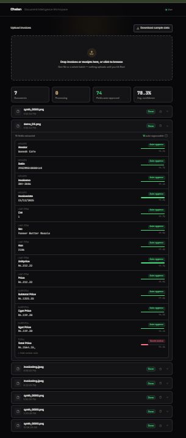

# Chalan — Document Intelligence for Indian Invoices

Turn a photographed or scanned Indian invoice/receipt into structured, field-level data — vendor, GSTIN, invoice number, date, line items, GST breakdown, total — with an honest per-field confidence score, so low-confidence fields route to a human reviewer and the rest auto-approve (straight-through processing).

Built as a from-scratch ML + backend + frontend project: a fine-tuned LayoutLMv3 model, a calibrated confidence/STP layer, a FastAPI + Celery + Postgres + Redis backend, and a React workspace — all measured against real baselines, with every number in this README coming from an actual run, not an estimate.

## The problem

Businesses manually key in thousands of invoices a month (~3–4 minutes per bill). The goal here is: `image/PDF → structured fields` with a confidence score honest enough that a business can safely auto-approve the easy majority of fields and only route the genuinely uncertain ones to a human.

## What it looks like




Drop one receipt or a whole batch in at once. Each document gets its own live progress card (OCR → model → decoding), then an expandable, field-by-field result: green "Auto-approve" for fields the model is confident and correct on, red "Needs review" for anything a deterministic safety net or low model confidence flags — never silently wrong.

## Architecture

```
          ┌────────────┐     ┌──────────────┐     ┌───────────────────┐
  image → │  Tesseract   │ →  │  LayoutLMv3   │ →  │ plausibility-cap    │ → {field, value,
          │  (OCR)       │     │  + LoRA       │     │ confidence allowlist│    confidence}
          └────────────┘     └──────────────┘     └───────────────────┘

  FastAPI /upload → Postgres job row → Celery task (above pipeline) → Redis pub/sub
       ↓                                                                    ↓
  React workspace  ←───────────────────── websocket (live stage + result) ──┘
                    (polling fallback if the socket drops)
```

- **Model:** `microsoft/layoutlmv3-base` (133M params) + LoRA (PEFT) — r=8, only 0.7% of parameters trainable, fits a 6GB laptop GPU with bf16 + gradient accumulation. Fine-tuned on CORD (receipts) plus a hand-rendered synthetic Indian-invoice set for the fields CORD doesn't have (vendor, GSTIN, invoice number, date, HSN, CGST/SGST).
- **Confidence:** Guo et al. (2017) temperature scaling for calibration, plus a deterministic, non-ML "plausibility cap" that force-flags any price/count field whose extracted text doesn't match a strict numeric format — a safety net the model's own confidence can't always catch on out-of-distribution real photos.
- **Backend:** FastAPI, Celery + Redis for async per-document jobs with live websocket status push, Postgres for job persistence, Tesseract for OCR on real uploads.
- **Frontend:** React 19 + Vite + TypeScript + Tailwind CSS v4 — staged batch upload, parallel per-document progress, tiered review UI.

## Results

Every number below is from a real run on a held-out set; methodology and full per-field breakdowns are in [`claude/results-log.md`](claude/results-log.md) — nothing here is backfilled or estimated.

### Extraction accuracy, baseline → fine-tuned

| Stage | Exact match | ANLS |
|---|---|---|
| OCR + regex rules (Baseline A) | 2.0% | 2.5% |
| Pretrained LayoutLMv3, zero-shot (Baseline B) | 42.6% | 44.1% |
| **Fine-tuned LoRA, CORD only** | 86.8% | 88.1% |
| **+ synthetic Indian invoices, CORD-only fields (no forgetting)** | 89.5% | 90.4% |
| **+ synthetic Indian invoices, new field types in isolation** | 100%* | 100%* |

\* Expected on clean, machine-rendered synthetic data — not a claim of real-world readiness. The real finding: the model learned 7 field types it had never seen (vendor, GSTIN, invoice no., date, HSN, CGST, SGST) purely from synthetic supervision, with zero regression on the fields it already knew.

The jump from 2% to 42.6% is OCR+rules being genuinely bad on noisy real photos (diagnosed, not assumed — see results log). The jump from 42.6% to 86.8% is task-specific fine-tuning on the real train split outperforming an imported zero-shot checkpoint, evaluated under the same strict positional-exact-match methodology both times (stricter than the standard NER seqeval metric, so these numbers are not directly comparable to published LayoutLMv3/CORD leaderboard scores).

### Calibration & straight-through processing (STP)

Temperature scaling (T=0.95, barely needed — the model came out of training already close to well-calibrated: test-set ECE 1.03% → 0.96%).

| Confidence threshold | % of fields auto-approved | Error rate among those |
|---|---|---|
| 0.70 | 91.6% | 3.51% |
| 0.80 | 89.8% | 3.24% |
| **0.90** | **85.7%** | *2.52%** |
| 0.95 | 81.6% | 2.34% |
| 0.99 | 65.7% | 1.53% |

At a 90% confidence threshold, 85.7% of all extracted fields can be auto-approved with a 2.52% error rate among those — the rest route to a human reviewer. This threshold/tradeoff table, not a single accuracy number, is the actual business decision an STP system is for.

### Inference latency & quantization

| Backend | Size | Latency/doc | Exact match | ANLS |
|---|---|---|---|---|
| PyTorch fp32, GPU (RTX 4050) | 507.5 MB | **50.2 ms** | 91.46% | 92.26% |
| PyTorch fp32, CPU | 507.5 MB | 1651 ms | 91.46% | 92.26% |
| ONNX fp32, CPU | 505.8 MB | 1993 ms | 91.46% | 92.26% |
| ONNX INT8, CPU | 128.5 MB | 1405 ms | 87.94% | 89.51% |

GPU dominates CPU by ~33x regardless of quantization — the bigger lever by far. INT8 quantization shrinks the model 4x and is the fastest CPU option, but costs a real ~3.5pp of accuracy — reported as a genuine tradeoff, not a free win.

## Real-world testing (not just the clean benchmark)

Every number above is on held-out CORD/synthetic data. The project was also tested against real photographed Indian restaurant bills — the much harder, out-of-distribution case a resume number alone doesn't capture.

**The honest headline: the deterministic plausibility-cap safety net has a perfect record across all 4 real bills tested — every garbled price, total, or count field was correctly flagged "Needs review," and none was ever silently auto-approved wrong.** Line-item extraction (item name, price, quantity, unit price) also held up strong on real photos — 94–99.8% confidence and correct, every bill, wherever the print itself was legible.

The one field that stayed unreliable on real bills: **vendor name**. A real bill triggered a confidently-wrong extraction early on (a POS receipt's "Cashier: biller" line was mistaken for the vendor, at 97.5% confidence) — diagnosed to a specific training-data gap, fixed, and verified: that exact bug is gone. But real-bill testing surfaced that vendor extraction has more than one failure mode (truncation, missing spans, OCR noise on badly-printed receipts) that a handful of synthetic training examples can't fully cover without a real labeled dataset, which was out of scope to collect for this project. It's documented here rather than hidden, and the system is explicit about it: vendor name on a real photo is never auto-approved with unjustified confidence — it's flagged for review, which is the correct, safe behavior even with the field itself unsolved.

Full diagnosis, every fix, and the complete before/after real-bill results are in [`claude/results-log.md`](claude/results-log.md).

## Known gaps (not silently dropped)

- **"Download sample data" button** exists in the UI but the backend bundle isn't built yet — currently 404s.
- **Review-with-bounding-box-highlight** (image + overlay of where each field was found) isn't implemented — the API returns `{value, confidence}` per field, no coordinates.
- **Vendor-name extraction on real photographed bills** — see above. The safety net around it works; the field itself doesn't always.

## Running it locally

Requires Python 3.13, Node 20+, Docker, and (for the real model) an NVIDIA GPU — `INFERENCE_BACKEND=dummy` in `.env` runs the full stack without one, for exploring the API/frontend without a model loaded.

```bash
# 1. Postgres + Redis
docker compose up -d

# 2. Python deps + env
python -m venv venv && source venv/bin/activate  # or venv\Scripts\activate on Windows
pip install -r requirements.txt
cp .env.example .env

# 3. API + worker (two terminals)
uvicorn src.api.main:app --reload
celery -A src.api.celery_app worker --loglevel=info --pool=solo   # --pool=solo is Windows-only

# 4. Frontend
cd frontend && npm install && npm run dev
```

Try it with the sample invoices in `data/demo_samples/` (synthetic, safe to share) or `data/real_test_samples/` (real photographed bills used for the real-world testing above).

## Training the model yourself

```bash
python src/models/train_lora.py --data combined --epochs 20   # needs a CUDA GPU, ~90 min on an RTX 4050
python scripts/eval_combined_model.py                          # field-level eval on the held-out dev set
```

See `claude/project-plan.md` for the full phase-by-phase build log and every design decision's reasoning.

## Tech stack

**ML:** PyTorch, HuggingFace Transformers, PEFT (LoRA), ONNX Runtime, Tesseract OCR
**Backend:** FastAPI, Celery, Redis, PostgreSQL, SQLAlchemy, Docker
**Frontend:** React 19, Vite, TypeScript, Tailwind CSS v4, GSAP

---

Built by [Vyankatesh Kulkarni](mailto:vyankateshk1604@gmail.com).
